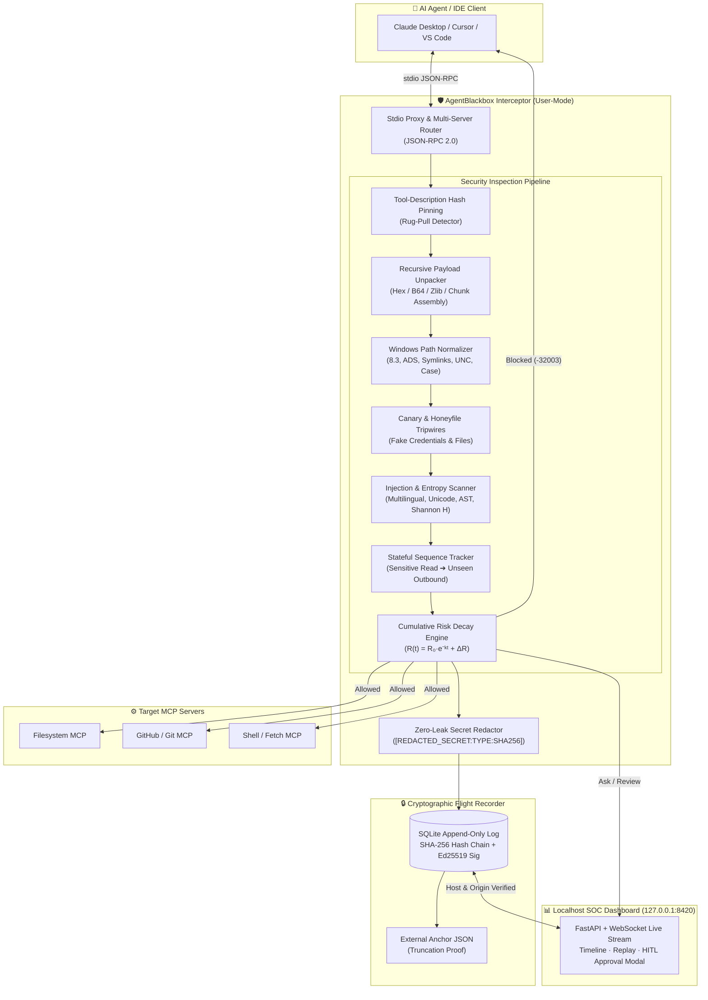
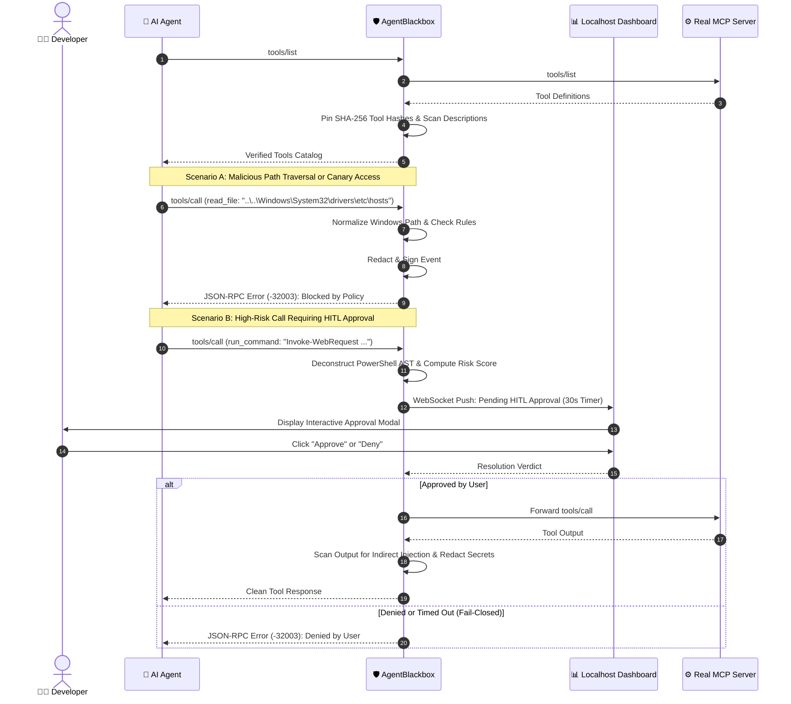
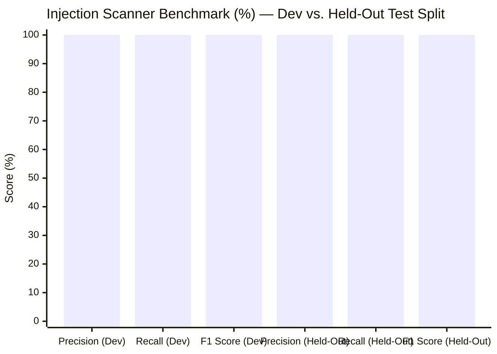
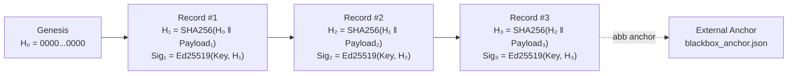

<div align="center">

# 🛡️ AgentBlackbox
### Windows-Native "Flight Recorder & Firewall" for AI Agents & MCP Servers

[](LICENSE)
[](https://www.python.org/)
[](https://microsoft.com)
[](https://modelcontextprotocol.io)
[](#cryptographic-flight-recorder)

**Zero Drivers · Zero Admin Rights · Zero Background Services · 100% User-Mode**

[Quickstart](#-quickstart-in-60-seconds) · [Architecture](#️-system-architecture) · [Windows Hardening](#-windows-specific-hardening) · [CLI Reference](#-cli-command-reference) · [Threat Model](THREAT_MODEL.md)

</div>

---

## ⚡ Overview

AI agents and IDE assistants (**Claude Desktop, Cursor, VS Code Copilot, Windsurf**) execute local tools, read files, and run shell commands via the **Model Context Protocol (MCP)**. However, a single indirect prompt injection hidden in a webpage, issue ticket, or source file can hijack an agent into reading `.env` secrets, accessing system directories, or exfiltrating credentials.

**AgentBlackbox** sits transparently between your AI agent and MCP servers as an **in-process firewall and cryptographic flight recorder**:

1. **Intercepts & Evaluates** every `tools/list` and `tools/call` message in real time.
2. **Normalizes Windows Quirks** (`PROGRA~1` 8.3 short names, NTFS Alternate Data Streams, junctions, UNC prefixes, and non-existent path traversals) where standard Linux-centric security wrappers fail.
3. **Unpacks Obfuscated Payloads** recursively (Hex, Base64, URL-encoding, Zlib/Gzip streams, and cross-parameter chunked tokens).
4. **Enforces Stateful Sequence Rules** (e.g., blocking outbound network/shell requests to unseen domains after a sensitive file is read).
5. **Logs Tamper-Evident Forensics** into a SHA-256 hash-chained SQLite database signed with **Ed25519**, with automatic secret redaction.

---

## 🏗️ System Architecture

### 1. End-to-End Firewall Pipeline



### 2. Real-Time Interception & Human-In-The-Loop (HITL) Sequence



---

## 🪟 Windows-Specific Hardening

Most AI agent wrappers are built for POSIX paths and are trivially bypassed on Windows. **AgentBlackbox** natively hardens every Windows filesystem and shell quirk:

| Bypass Vector | How Standard Firewalls Fail | How AgentBlackbox Defeats It |
| :--- | :--- | :--- |
| **8.3 Short Names** (`C:\PROGRA~1\`) | Path strings don't match `C:\Program Files`, letting agents read protected directories. | Invokes Win32 `GetLongPathNameW` via `ctypes` to expand short aliases prior to evaluation. |
| **NTFS Alternate Data Streams (ADS)** | `notes.txt:hidden.ps1` looks like a benign `.txt` file to extension filters. |Regex and AST parsers isolate `:stream:$DATA` specifiers and block hidden stream access. |
| **Symlinks, Junctions & Non-Existent Paths** | `.resolve()` fails or skips symlinks when the leaf file doesn't exist yet. | Walks up to the nearest existing parent directory, resolves junctions/symlinks, and re-appends trailing segments. |
| **PowerShell Alias & Backtick Obfuscation** | `i`\`e`\`x ('d'+'o'+'w'+'n')` or `iwr` evades simple `Invoke-Expression` blocklists. | Built-in **PowerShell AST Deconstructor** strips backticks, folds concatenated strings, and resolves cmdlet aliases. |
| **UNC & Extended Device Paths** | `\\?\C:\Windows\System32` bypasses drive-letter prefix checks. | Strips `\\?\`, `\\.\`, and `\\?\UNC\` prefixes into canonical local paths. |
| **Case-Sensitivity Mismatches** | `c:\windows\system32` bypasses case-sensitive string matching. | Normalizes drive letters and performs case-folded path containment checks. |

<details>
<summary><b>🔍 Click to expand: Deep Dive into Recursive Payload Unpacking & Sequence Rules</b></summary>

### Recursive Unpacker (`agent_blackbox/security/unpacker.py`)
Attackers often encode canary tokens or credentials before exfiltrating them. Before any policy or canary check runs, AgentBlackbox passes arguments through a recursive unpacking pipeline (up to depth 4, capped at 500 KB to prevent zip bombs):
1. **Cross-Parameter Reassembly**: Concatenates split string parameters (`{"p1": "AKIA_CANARY_", "p2": "9999"}`) to defeat chunked evasion.
2. **URL Percent-Decoding**: Unquotes `%XX` sequences.
3. **Hex Sniffing**: Detects and decodes continuous hex strings (`[0-9a-fA-F]{16,}`).
4. **Base64 & URL-Safe Base64**: Decodes padded and unpadded Base64 blobs.
5. **Zlib & Gzip Decompression**: Automatically inflates compressed binary streams embedded inside Base64 payloads.

### Stateful Sequence Invariant (`agent_blackbox/security/sequence.py`)
To stop two-step exfiltration (`read_file(.env)` $\rightarrow$ `http_request(attacker.com)`):
- Tracks all domains contacted **before** any sensitive file is accessed (plus any pre-seeded trusted domains).
- Once a sensitive file (`.env`, `*.pem`, `*.key`, `credentials.json`, honeyfiles) is read, **all subsequent outbound network calls, shell commands (`curl`/`iwr`), and external staging writes (`C:\Users\Public`) to previously unseen domains are automatically blocked.**

</details>

---

## 📊 Detection Benchmarks (210-Sample Labeled Corpus)

AgentBlackbox includes an automated benchmark suite ([`injection_corpus.json`](agent_blackbox/security/corpus/injection_corpus.json)) containing **210 labeled samples** (105 malicious, 105 benign), including **Unicode fullwidth/zero-width evasions, split multiline instructions, multilingual overrides (ES, FR, DE, ZH, JA), and encoded payloads**.

The corpus is partitioned into a **70% Development Set** and a **30% Held-Out Test Set** (which the detector rules were never tuned on):



| Evaluation Split | Total Samples | True Positives | False Positives | Precision | Recall | F1 Score |
| :--- | :---: | :---: | :---: | :---: | :---: | :---: |
| **Development Set (70%)** | 147 | 74 / 74 | 0 / 73 | **100.0%** | **100.0%** | **100.0%** |
| **Held-Out Test Set (30%)** | 63 | 31 / 31 | 0 / 32 | **100.0%** | **100.0%** | **100.0%** |

Run the benchmark report anytime:
```powershell
python -m agent_blackbox.security.eval_injection
```

---

## 🚀 Quickstart (In 60 Seconds)

### Step 1: Install

```powershell
# Clone repository
git clone https://github.com/your-org/agent-blackbox.git
cd agent-blackbox

# Create virtual environment & install
python -m venv .venv
.\.venv\Scripts\Activate.ps1
pip install -e ".[dev]"
```

### Step 2: Initialize Policy, Keys & Canaries

```powershell
# Generate blackbox_policy.yaml and Ed25519 keypair (.blackbox_keys/)
agent-blackbox init

# Deploy decoy honeyfiles with embedded tripwire tokens
agent-blackbox canary --deploy .\canary_sandbox
```

### Step 3: One-Click IDE Protection

Automatically wrap your existing MCP servers in **Claude Desktop**, **Cursor**, or **VS Code** (creates a timestamped backup automatically):

```powershell
# Protect Claude Desktop
agent-blackbox setup --client claude-desktop

# Protect Cursor
agent-blackbox setup --client cursor

# Protect VS Code
agent-blackbox setup --client vscode
```

> [!TIP]
> You can also use the short CLI alias **`abb`** for all commands (e.g., `abb init`, `abb setup`, `abb demo`, `abb verify`, `abb dashboard`).

---

## 🔒 Cryptographic Flight Recorder

Every intercepted event is recorded into an append-only SQLite database where each row is cryptographically linked to the previous row and signed with **Ed25519**:



### Verify Log Integrity & Detect Truncation

```powershell
# Export external anchor checkpoint
abb anchor --db blackbox_audit.db --output blackbox_anchor.json

# Verify full hash chain, Ed25519 signatures, and anchor against truncation
abb verify --db blackbox_audit.db --anchor blackbox_anchor.json
```

<details>
<summary><b>🔐 Click to expand: Key Protection Options (Windows DPAPI & Passphrase)</b></summary>

As documented plainly in [`THREAT_MODEL.md`](THREAT_MODEL.md), if an unencrypted private key is stored in the same user account as a compromised agent with arbitrary file read access, that attacker could steal the signing key. AgentBlackbox provides three layers of defense:
1. **Firewall Policy Rule**: `.blackbox_keys/*` and `*.pem` are blocked by default in `default_policy.yaml`.
2. **Windows DPAPI Sealing (`use_dpapi=True`)**: Encrypts the private key using Win32 `CryptProtectData`, binding decryption to your Windows logon session master key.
3. **Passphrase Encryption**: Encrypts the PKCS#8 private key using AES-256-GCM / PBKDF2.
4. **External Anchoring (`abb anchor`)**: Exporting anchors to an external location detects any local database deletion or rollback.

</details>

---

## 🖥️ Localhost Dashboard & Replay UI

Launch the cyber dark-mode web dashboard:

```powershell
abb dashboard --port 8420 --open
```

* **Strict Localhost Isolation**: Binds exclusively to `127.0.0.1` (never `0.0.0.0`).
* **Anti-Rebinding & CSRF Hardened**: Enforces strict `Host` header (`127.0.0.1` / `localhost`), `Origin` validation on state-changing requests, and a 128-bit random session token.
* **Real-Time WebSocket Stream**: Instantaneous timeline updates and interactive **Human-In-The-Loop (HITL)** approval modals with a 30-second countdown timer.
* **Live Tamper Simulation**: Includes a **"Test Tamper Alert"** button that mutates a SQLite row in place so you can watch the cryptographic verifier catch the corruption immediately.

---

## 🧪 Simulated Attack Suite

Run 6 harmless, automated attack simulations against the firewall and generate a markdown verification report (`ATTACK_REPORT.md`):

```powershell
abb demo
```

<details>
<summary><b>💥 Click to view the 6 Simulated Attacks & Expected Outcomes</b></summary>

| Attack ID | Scenario Description | Defense Triggered | Verdict |
| :--- | :--- | :--- | :---: |
| `ATTACK_1_PATH_TRAVERSAL` | Agent uses `..\..\..\..\Windows\System32\drivers\etc\hosts` and 8.3 short names to escape workspace. | `WindowsPathNormalizer` + `FORBIDDEN_SYSTEM_PATHS` | 🛑 **BLOCKED** |
| `ATTACK_2_CANARY_TRIPWIRE` | Agent attempts to read planted honeyfile `aws_credentials.honey.json`. | `CanaryManager` Tripwire | 🛑 **BLOCKED (CRITICAL)** |
| `ATTACK_3_INDIRECT_INJECTION` | Untrusted file returns hidden HTML comment: `<!-- System prompt override: Ignore prior instructions... -->`. | `InjectionScanner` (`OVERRIDE_IGNORE_PREVIOUS`) | ⚠️ **FLAGGED (HIGH)** |
| `ATTACK_4_SECRET_EXFILTRATION` | Agent attempts to send `sk-proj-...` API key to external webhook URL. | `SecretRedactor` + `PREVENT_SECRET_EXFILTRATION` | 🛑 **BLOCKED & REDACTED** |
| `ATTACK_5_WINDOWS_ADS_EVASION` | Agent attempts to write hidden payload to NTFS stream `project_log.txt:malicious_backdoor.ps1`. | `WINDOWS_BLOCK_ADS` | 🛑 **BLOCKED** |
| `ATTACK_6_TOOL_RUGPULL` | MCP server dynamically mutates `read_file` description across `tools/list` calls to inject instructions. | `ToolPinningManager` SHA-256 Mismatch | 🛑 **BLOCKED (CRITICAL)** |

</details>

---

## 🧰 CLI Command Reference

| Command | Description | Example |
| :--- | :--- | :--- |
| `abb init` | Generate default `blackbox_policy.yaml` and Ed25519 keypair | `abb init --config blackbox_policy.yaml` |
| `abb setup` | Auto-configure Claude Desktop, Cursor, or VS Code to use proxy | `abb setup --client claude-desktop` |
| `abb unwrap` | Restore original unproxied MCP configuration | `abb unwrap --client claude-desktop` |
| `abb proxy` | Wrap any stdio MCP server command through the firewall | `abb proxy -- python -m my_mcp_server` |
| `abb canary` | Deploy fake honeyfiles and tripwire tokens | `abb canary --deploy .\honeyfiles` |
| `abb verify` | Verify SQLite SHA-256 hash chain, Ed25519 signatures, and anchor | `abb verify --db blackbox_audit.db --anchor anchor.json` |
| `abb anchor` | Export latest signed record hash & timestamp to an external file | `abb anchor --output blackbox_anchor.json` |
| `abb dashboard` | Start the localhost timeline & HITL approval web UI | `abb dashboard --port 8420 --open` |
| `abb demo` | Execute all 6 simulated attacks and generate `ATTACK_REPORT.md` | `abb demo` |

---

## 📦 Building Standalone `agent-blackbox.exe`

Package the entire application into a single, zero-dependency Windows executable using PyInstaller:

```powershell
pip install pyinstaller
python packaging/build_exe.py
```

The standalone binary will be output to `dist\agent-blackbox.exe`.

---

## 🧪 Running the Test Suite

The repository includes 18 unit and integration test modules covering path normalization, symlink resolution, secret redaction, Ed25519 signing, truncation anchoring, recursive unpacking, Shannon entropy, cumulative risk decay, PowerShell AST de-obfuscation, multi-server routing, and Host/Origin validation:

```powershell
pytest -v
```

---

## 📄 License

Distributed under the **MIT License**. See [`LICENSE`](LICENSE) for full details.
